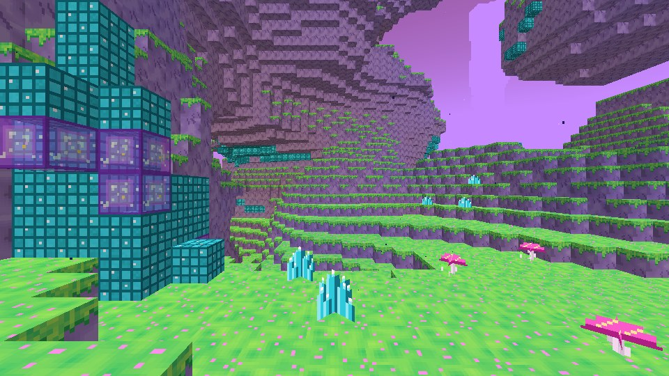
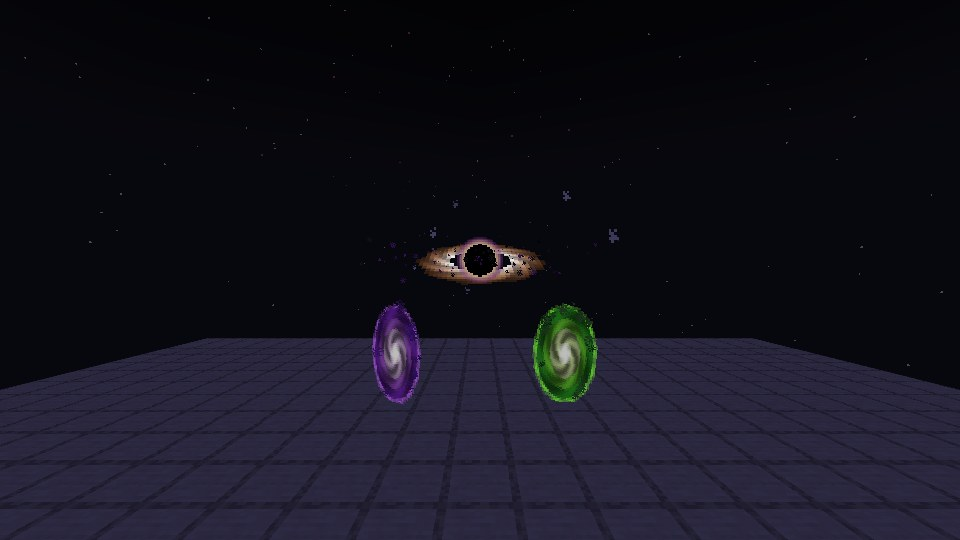
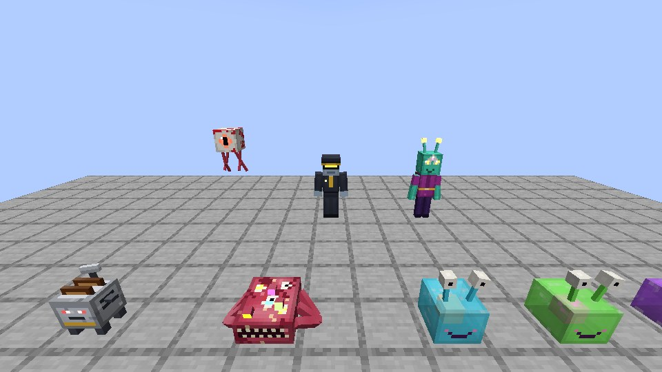
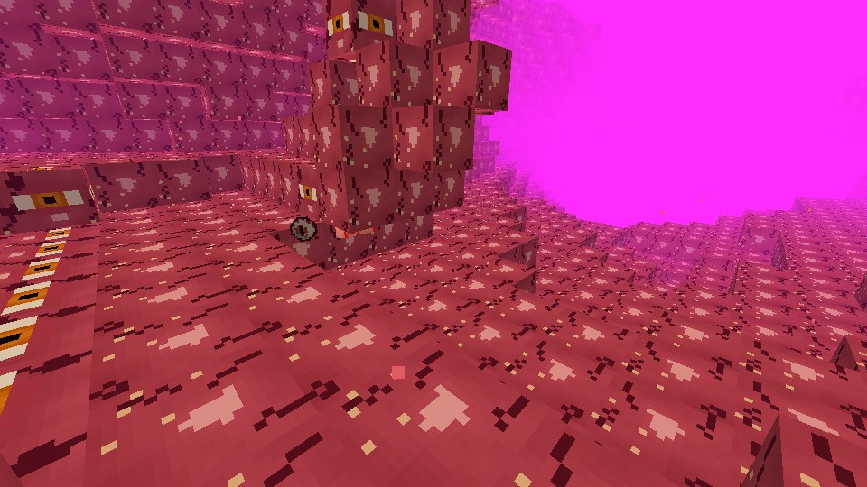
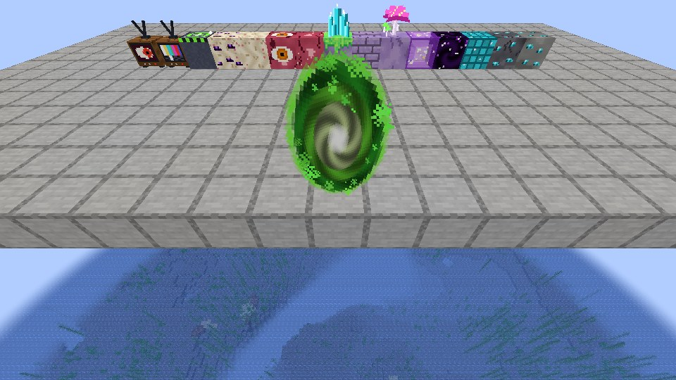
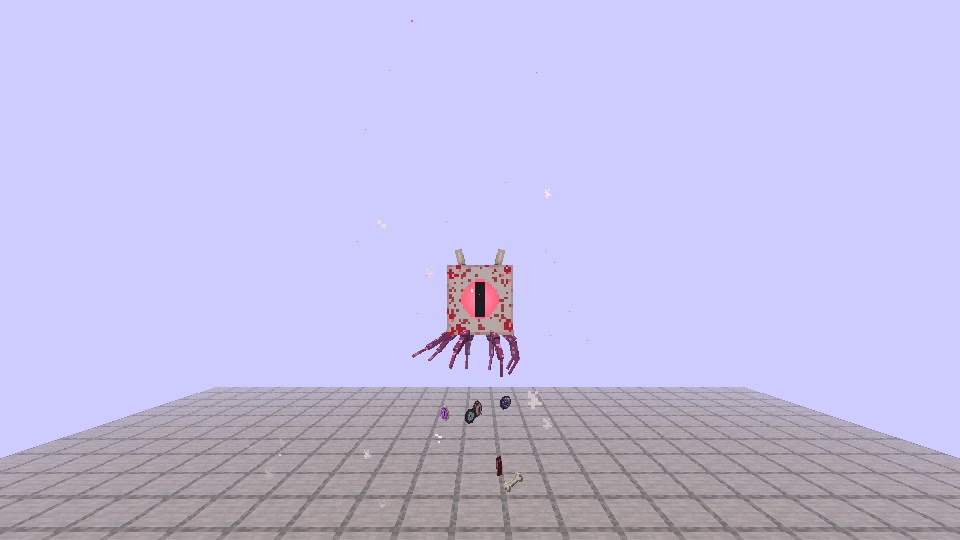

# Multiverse Mayhem

An interdimensional mad-science mod for **Minecraft 1.21.1 (Fabric)**: portal guns, a bouncy jelly dimension, a dimension made entirely of meat, sentient toasters, size rays, pocket black holes, interdimensional customs agents, and a very large, very angry eyeball.

It's built for real survival play. You start in the Overworld with a pickaxe, and there's a full progression from your first Flux Crystal to a boss fight that unlocks an endgame portal gun.

> Requires **Fabric Loader ≥ 0.16** and **Fabric API** for 1.21.1. Java 21.

| | |
|---|---|
|  |  |
| *Arriving in the Gloopverse through a portal* | *Portal Gun and Omni portals, plus a Pocket Black Hole* |
|  |  |
| *Defense Toaster, Meat Crawler, Gloopers, Customs Agent, Zorp, Watcher* | *The Meatverse (pictured with night vision)* |
|  |  |
| *A freshly fired portal* | *The Omni-Eye in its enraged phase* |

All screenshots were captured automatically by the headless autotest (see below).

---

## The progression in one picture

```
Overworld                          Gloopverse                      Meatverse
─────────                          ──────────                      ─────────
Flux Crystal Ore (y < 40) ──► Portal Fluid ──► PORTAL GUN ──► Gloop, Gloopers, Wobble Shrooms
Crashed Saucers (loot!)                          │               Flux Spires, low gravity
                                                 └──────────► Dark Matter, Watcher Eyes
                                                                 │
                         Eye Bait ◄──────────────────────────────┘
                            │
                     THE OMNI-EYE (boss) ──► Omni-Lens ──► OMNI PORTAL GUN (infinite, reaches the End)
```

Every new player gets a **Lab Notes** book the first time they join. It walks through all of this in game.

---

## Features

### The Portal Gun
- **Use** fires a glowing blob of portal fluid. Wherever it lands (wall, floor, ceiling, mob, or mid-air after a few seconds), a swirling portal opens, and a **linked return portal** opens at the destination.
- **Sneak + Use** cycles the destination: **Home** (your bed/spawn) · **Overworld** · **Nether** (coordinates scaled 1:8) · **Gloopverse** · **Meatverse** · **Scramble** (random dimension, up to ±1500 blocks away).
- Anything can travel through a portal: players, mobs, items, minecarts with passengers.
- If the destination is solid rock or open void, the gun searches for a safe spot. If it can't find one, it builds an **Emergency Landing Pad**.
- It runs on **Portal Fluid**. Each fluid gives 4 charges, and the gun reloads automatically from your inventory. A **Microverse Battery** in your inventory slowly recharges it for free.
- **Coordinate Cards**: use one on a block to bookmark it. Hold the card in your off-hand while you fire to portal straight to that exact spot, even across dimensions.
- **Omni Portal Gun** (endgame): needs no fluid, fires faster, opens longer-lasting purple portals, and can reach **The End**.

### Dimensions
| | Gloopverse | Meatverse |
|---|---|---|
| Terrain | Floating islands of Gloopstone and neon Gloop Grass, Jelly Shallows of bouncy Gloop | A sealed cave world made of flesh, with gristle deep down and lakes of red "water" |
| Physics | **Low gravity** (half gravity, extra safe fall distance) | Beds explode |
| Sky | Permanent pink sunset | Blood-red fog |
| Life | Gloopers, Zorp the trader, the occasional Thought Leech | Meat Crawlers, Watchers, Thought Leeches |
| Loot | Gloop, Wobble Shrooms, Flux Clusters and glowing Flux Spires | **Dark Matter Ore**, Eye Flesh, Watcher Eyes |

### Creatures (all have custom models, textures, animations, sounds and AI)
- **Glooper**: a translucent jelly blob with eye-stalks and a glowing core, in three colours. Tame it with a **Flux Crystal**. It follows you, body-slams enemies into the air and breeds with Wobble Shrooms. Heal it with Gloop Balls. Empty-hand **sneak + use** puts it **on your head**, where it cancels all fall damage. Sneak to put it down.
- **Meat Crawler**: a six-legged slab of meat with too many eyes. It pounces, causes hunger, and **splits into smaller crawlers** when killed.
- **Watcher**: a floating eyeball with dangling nerves. It circles you at range and fires eye beams that slow you and make you glow.
- **Thought Leech**: leaps onto your head and drains your XP and hunger, with nausea. **Sneak three times quickly** to shake it off. Jumping in water or going through a portal also works.
- **Zorp**: a three-eyed interdimensional salesman who takes Flux Crystals and emeralds. Sometimes he follows your portal signature to you. He sells Portal Fluid, Hyper Seeds, Mystery Jars, Toaster Cores, Dimensional Permits, Microverse Batteries and more.
- **Interdimensional Customs Agent**: open too many portals in a short time and **Customs shows up to audit you**. Agents carry stun batons and **confiscate your Portal Fluid**. Kill them to get it back, or carry a **Dimensional Permit** and they'll leave you alone.
- **Defense Toaster**: place a **Toaster Core** to boot up a loyal turret. It follows you, sits on command, and lobs **flaming burnt toast** at monsters. Repair it with bread.
- **THE OMNI-EYE** (boss, 360 HP): summon it in the Meatverse with **Eye Bait**. In phase 1 it fires beam volleys and summons crawlers. Below 50% it **turns blood-red**, then blinks around the arena, drags players into its gaze with Darkness, and calls in Watchers. It drops the **Omni-Lens**.

### Gadgets & gear
| Item | What it does |
|---|---|
| **Size Ray** | Shrinks or enlarges any creature (look straight down to zap yourself). Uses the real `scale` attribute, so hitboxes, reach and step height all change. Sneak-use to switch between Shrink, Enlarge and Restore. |
| **Quantum Swapper** | Instantly swap places with the creature you're aiming at (32 block range). |
| **Plasma Blaster** | Fires superheated plasma bolts that burn and knock back. Repair it with Flux Crystals. |
| **Pocket Black Hole** | Throw it to open a 7-second singularity. It drags in mobs and items, crushes anything at its core, then collapses with a bang and spits the swallowed items back out. |
| **Jar of Questionable Contents** | 15 possible outcomes: diamonds, a pet Glooper, a swarm of leeches, confetti, anti-gravity, Zorp himself, or "it was a bomb jar". |
| **Interdimensional TV** | Right-click it to tune into 14 absurd channels from across the multiverse. Each broadcast has a side effect, and the screen is animated (static, test card, portal, a staring eye). |
| **Hyper Seed** | One minute of HYPER: speed, jump, attack speed and mining speed. Then **the crash**. |
| **Flux tools** | Diamond-tier tools. The **Flux Pickaxe** mines 3×3 (sneak for a single block), and the **Flux Sword** chains lightning to 3 nearby monsters. |
| **Lab Goggles / Gloop Boots** | Night vision / no fall damage + jump boost. |
| **Music Disc** | *Glorbo – Interdimensional Jam*, an original 60-second chiptune track. |

### World generation
- **Flux Crystal Ore** (stone and deepslate) throughout the Overworld below y = 40.
- **Crashed Saucers** on the Overworld surface: tilted hulls, cracked glass domes, scorched earth, and a loot chest with salvage (Portal Fluid, Coordinate Cards, gadgets, and an 8% chance of a pre-built Portal Gun).

### Advancements
14 advancements, starting from *Multiverse Mayhem* and running through *Hole Punch*, *Gloop, There It Is*, *Meat and Greet*, *Paperwork*, *Fully Licensed* and *I See What You Did There*, up to *Omnipresent*.

---

## Key recipes
All recipes show up in the recipe book. Highlights:

- **Portal Fluid ×2**: Flux Crystal + Slime Ball + Glass Bottle (or ×3 with a Gloop Ball instead of the slime)
- **Portal Gun**:
  ```
  Flux   LimeGlass  PortalFluid
  Iron   Diamond    Iron
  Iron
  ```
- **Omni Portal Gun**: Omni-Lens over Dark Matter Block, Portal Gun, Dark Matter Block, with a Microverse Battery underneath
- **Eye Bait**: 4 Watcher Eyes + Raw Mystery Meat + Dark Matter + Bone
- **Toaster Core**: Iron, Bread, Flux Crystals, Redstone Block

---

## Building from source
```bash
./gradlew build                # -> build/libs/multiverse-mayhem-1.0.0.jar
./gradlew runClient            # dev client
tools/smoke_test.sh            # headless server test: generates both dimensions, places every feature, summons every mob
./gradlew runAutotest          # dev client that stages scenes and screenshots them to run/screenshots
                               # (needs a world at run/saves/autotest; inert unless -Dmayhem.autotest=true)
```
The autotest also fires the Portal Gun at the floor, walks the player through the portal, and logs which dimension they end up in. That makes it an end-to-end check of the headline feature.

### Procedural asset pipeline
Every texture, model, sound and JSON file is generated by scripts in `tools/`. They're reproducible and easy to tweak:

| Script | Generates |
|---|---|
| `tools/gen_models.py` | Java entity model classes **and** their UV-matched textures from a single spec, so geometry and art can't drift apart (with a UV-overlap checker) |
| `tools/gen_textures.py` + `tools/sprites.py` | Hand-drawn 16×16 item sprites, procedural blocks (animated Flux, Dark Matter, blinking Eye Flesh, TV screens), the portal swirl, the black hole, armour layers, effect icons and the mod icon |
| `tools/gen_sounds.py` | 42 synthesized sound effects (FM zaps, formant-filtered alien babble, radio-crushed bureaucrats) plus the music disc, encoded to OGG with ffmpeg |
| `tools/gen_data.py` | Blockstates, models, lang, loot tables, recipes, tags, both dimensions (noise settings, biomes, features), advancements and the jukebox song |
| `tools/validate.py` | Cross-checks every Java registration against the assets |

```bash
python3 tools/gen_models.py && python3 tools/gen_textures.py && python3 tools/gen_sounds.py && python3 tools/gen_data.py && python3 tools/validate.py
```
(`gen_data.py` reads vanilla's noise-settings JSON. Point `VANILLA_DATA` at an extracted `data/minecraft` folder from the 1.21.1 client jar.)

## License
MIT
